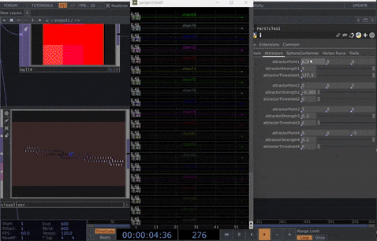

# Project Plan - grain3d

## Project Description: 

"grain3d" is a spatial granular synthesizer instrument aimed at mutlichannel / spatial audio scenarios in terms of multi media art installations & performances. The base idea consist of 2 main thoughts, the implementation of a granular syntheiszer which takes particle movements as modulation input for driving sound specific parameters, aswell as the idea of a spatial granular synthesizer which means that its grains hold spatial information in their attributes. Threedimensional, spatial information in my case. This also means that the instrument needs a audio rendering system & multichannel audio output capabilities. 

My environment of development is TouchDesigner, in there "grain3d" can be seen as a combination of 3 major components: 

### 1. Audio VST Synthesizer  

The Audio Programming & Synthesis Part is entirely done in Max / RNBO. The RNBO Environment allows for direct export to C++ Source Code, aswell as VST3 format, which makes it especially suited for my development. 

In the current state of development i decided to do the synthesis with the native "granulator" rnbo object. Better to say with 8 instances of it. All refer to the same buffer / sample file which can be loaded via the vst ui. I have an alternative version which enables the user to load samples for each instance separetely. In the future, it would be nice to make this a function, which can te toggled on or off. 

Same goes for the inital idea of spatial grains as, at the moment, each output voice of the instrument represent a stream of grains not a single grain channel, therefore the spatialization of single grains isn't directly possible. However there is a way of telling the "granulator" rnbo object that it should output multiple audio channels, these output channels refer to a 1 dimensional panning parameter which acts on the entire stream of grain aswell. I might need to investigate this fucntion further to see if I didnt missed a way to set the panning value separetly for each grain, then it would be possible to output single grain channels from the "granulator" object. 

### 2. Audio Rendering System 

The audio rendering system is entirely written and implemented in TouchDesigner. The developemnt of this component is quite far, as 3/5 days of the project weeks time went into this. 

To give a rough description, its a distance based amplitude panning system which works dynamically with any amount of speakers & sound sources. It takes the speaker positions as a csv table & the sound source positions as texture object since the calculation of the distances of each sound source positions to each speaker is allocated to the GPU via a GLSL compute shader. 

Optimization 
was the actual last step of development, before the distance calculation was running entirely on the CPU via a python script. I made some performance test on my Laptop Graphics "Card" RTX 3060 and 88 Speaker Positions with 8 Sound Sources, and the system was still performing ok but somewhere around 100 audio channels seems to be the limit. (for a Low End Gaming Laptop!) As for now the systems seem pretty stable and definitely scalable enough. Still: there are some minor bottlenecks left which could be optimized in further development. (s. Nice To Haves)

### 3. GPU Particle System 

This component is a Particle System fully implemented in TouchDesigner on a GLSL Compute Shader. It developed as personal project over the last year. So far, no relevant work on this component has been done for this project. I could just use it in the way that i stream particle positions out of the component as a texture, which then got fed into the input of the Audio Rendering System. However in the future some path following & force from curve functions should be implemented, to apply particle movement onto imported motion paths & simulations from houdini.  

In this context, my plan is also to build some houdini tools that allow quick creation of particle simulations or path generation accordingly to the virtualized speaker setup. So far, only 1 Houdini HDA Tool was build for this project which is a Attribute To Texture Exporter. That makes it easy to bake animations & simulations of point attributes into images & image sequences, which can directly be read by the Particle System in TouchDesigner.  

  

 

Best Case: 
- Audio Out Per Grain Function working in a clean way of making the synthesis engine outputting each grain to a dedicated fixed audio channel instead of mixing them together / trying to separate them post mix 
- Switch between one Sample for All & individual Sample for All in VST ui
- Easy To Use UI, Interaction & Modulation System Implemented  
- Force From Curve GLSL Function 
- Houdini Tools for Movement / Particle Simulation around Speaker Positions / in the individual scenario space 
- Houdini Tools for PAth / Curve Generation along Speaker Setup
- Presets for different Speaker Setups, Interesting Curve Patterns
- Further Optimized & Cleaned Up Audio Rendering System 
- some test Speaker Setup with some more advanced performance / installation usecase @ final presentation in april 
- improved binaural prelisten function
- 1 Big component with advanced Interface to control everything, no more need for to dive into the patch to control everything
- a little performance that is aesthetically interesting, so a more artistically rich showcasing of "grain3d"
- a little installation setup that has interactive elements [Interaction Implementation]

Worst Case: 
- Audio Out Per Grain Function in a hacky-post-mix-separation way, that gives at least an impression of how it might sound like with spatially different displaced grains
- alternatively a mode that understands each voice / grain stream as single grain, so each grainstream is only able to play 1 grain at a time which then needs to be triggered across all voices
- 2 versions - one Sample for all Voices Version, Individual Samples for all Vocies Version
- some specific Interaction & Modulation Implementations as showcase 
- Path Follow GLSL Function
- some example Curves / Particle Simulations for showcase
- Audio Rendering System in the state it is now 
- some test Speaker Setup with some test patches for showing performance / installation usecase @ final presentation in april 
- general, binaural prelisten function 
- 1 big component with minimal Interface to control everything needed
- a little performance & installation @ final presentation that is showcasing "grain3d" sufficiently 
- a little installation setup that has only generative elements [No Interaction Implementation]

