# "grain3d" - Documentation First Term Project 

## Initial Idea 

The description of the initial Idea can be found [here](./../documentation/pdf/Orientierungsprojekt.pdf).  

## Concept

"grain3d" is threedimensional spatial granular synthesizer. The spatial movement aswell as the modulation source data is generated by a particle system & other inputs. The initial idea was that each grain is handled as a separate sound source by the audio rendering system. As I encountered problems achieving this functionality, the concept of this version is that there are 8 voices / grain streams that are associated with 8 particles. There is a [VST](./../assets/vst/grain3d.vst3) version that uses the same sample/buffer for each voice, aswell as a [VST](./../assets/vst/grain3dmultipleBuffers.vst3) version that uses 8 different samples/buffers per voice.

The playing style is intented to work via the control of particles by for example forces or simulated physics. Of course it can also be played by controlling traditional sound parameters. Another way of playing is via a Leap Motion Device and the hands/fingers. 

It's aimed at installative or performative usecases, especially where irregular multichannel speaker setups are utilized.  

## Overview & User Interface 

The Interface is structured into a Menubar, the Soundpartikel Menu Section and the Global Setting Menus Section.

### <ins>Menubar</ins> 

This Section is really self-explanatory. There is: 
- "Add Preset" Button
- "Delete Preset" Button
- "Load Preset" Dropdown Menu 
- FPS Monitor 
- "Binaural Listening" Button

### <ins>Soundpartikel Section</ins>
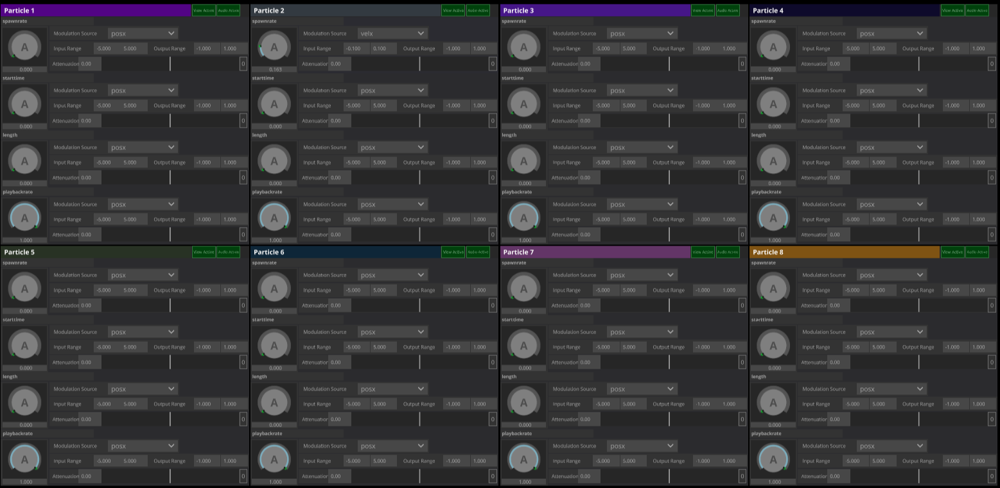
 

  

#### Soundpartikel - Parameter Module

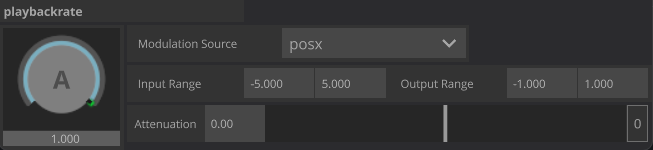

 

At the base of this section sits this UI Module, which holds all controls for 1 Sound Parameter:

There is: 
1. "A" Value Knob
    - Sets the Base Value of the Parameter (pre modulation parameter value)
    - Green Light is indicating where the actual value is at (post modulation parameter value)

2. "Modulation Source" Dropdown Menu 
    - is defining which Modulation Source & it's Settings will be displayed on the UI
    - a list of all the available inputs can be found [here]("./../../assets/csv/Modulation_Sources.csv)

It was important for me to be able to modulate one parameter by multiple sources. Therefore, for every modulation source these UI Elements exist once: 

3. "Input Range Min" Float

4. "Input Range Max" Float

5. "Output Range Min" Float 

6. "Output Range Max" Float

7. "Attenuation" Slider

8. "Attenuation Reset to 0" Button

 

So, this base module controls one sound parameter of one voice. There are 4 parameters per voice, therefore 4 of these modules are building one voice module:

#### Soundpartikel - Voice Module

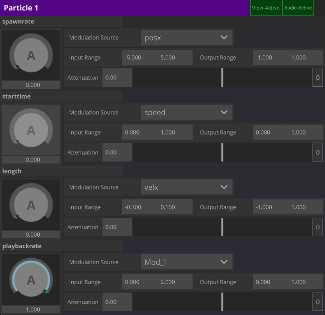

 

Additional Control per Voice Module: 
1. "View Active" Button
2. "Audio Active" Button

 
There are 8 voices.  
4 Parameter Modules are building 1 Voice Module. And 8 Voice Modules are building the whole Section. This is visualized in this image:

 

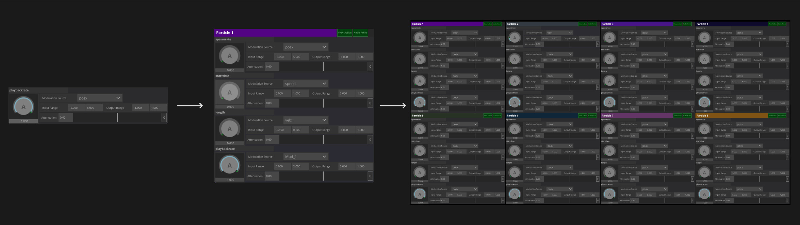

### <ins>Global Settings Section</ins>

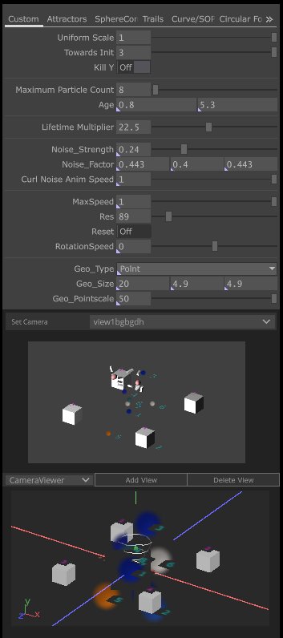

This section holds mutiple menus:

#### Global Settings Section - Global Particle Parameters  

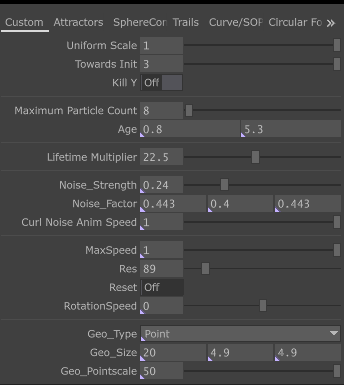
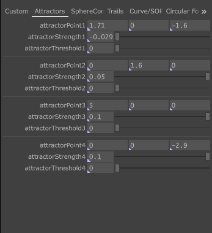
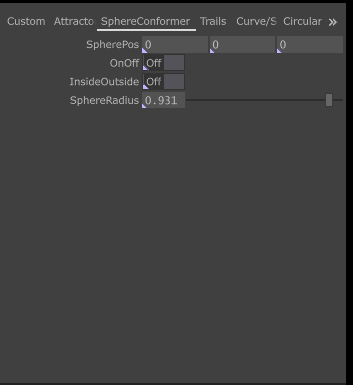
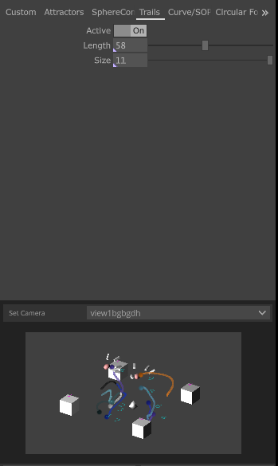
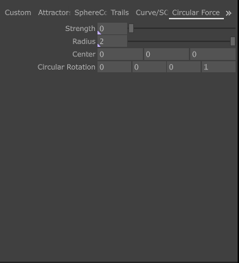

In this Menu Pages all of the relevant global particles functions are controlled.

Available Forces: 
- Force Towards Init Position ("TowardsInit")
- Curl Noise 
- Attraction
- ConformToSphere 
- Circular 

#### Global Settings Section - Camera Viewer

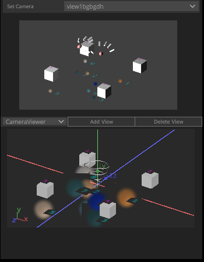

This section contains the following: 
1. "Set Camera" Dropdown Menu
    - Saved Views Can be loaded from here
2. "Camera View" Window
    - only for viewing
3. Dropdownmenu
    - 4.- 6. are only displayed if "CameraViewer" is selected
    - The following section "Interaction Menus" can be selected here
4. "CameraViewer" Window
    - for adjusting the camera, Rotate: hold left mouse button, Move: hold right mouse button , Zoom: scrollwheel 
5. "Add View" Button
    - Saves View into 1. 
6. "Delete View" Button 
    - Deletes the View loaded into 1.

#### Global Settings Section - Interaction Menus

When selecting "Interaction" instead of the "CameraViewer" another dropdownmenu ui object appears right next to it. From here it can be switched between the following Interaction Menus:

1. "Modulation" Menu  

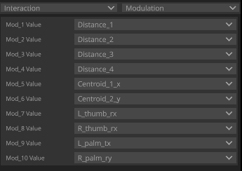

In the Modulation Sources (in Soundpartikel Section) there can be found 10 parameters named "Mod[1-10]". Unlike the other Sources, these parameters aren't fixed but variable. The "Modulation" Menu is the place to assign input data to these. This is the place for getting all the data, for example positions of single fingers tracked by the leap motion, into the system. A complete list of all available data inputs can be inspected [here]("./../../assets/csv/Mod_Variables.csv). Note that all Rotation Values are normalized from -180 to 180 degrees to -1 to 1 degrees. 

2. "Distances" Menu

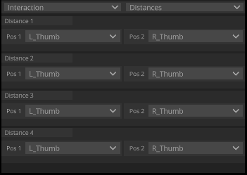

In this menu, the distances between two points are calculated. 4 Times separetely. All the available position data that can be assigned to the points can be viewed [here](./../assets/csv/Distance_Variables.csv). Using the distance values as modulation source is done via 1., so via assigning Distance_[1-4] to Mod[1-10].

3. "Centroids" Menu 

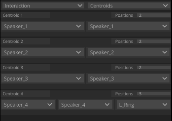

This menu follows the idea of 2., so that interrelated data can be more meaningful then raw data. In this case the centroid position between 2-8 points is calculated. 4 Times separately. The number of points can set via the "Positions" Integer Value. The positions of the points can be selected via the corresponding dropdown menus. A complete list of all position data inputs can be found [here]("./../../assets/csv/Centroid_Variables.csv). Using the centroid position values as modulation source is done the same way as in 2.

## Audio Synthesis 

The Audio Programming & Synthesis Part is entirely done in Max / RNBO. The RNBO Environment allows for direct export to C++ Source Code, aswell as VST3 format, which makes it especially suited for my development. Coming to this conclusion took me some steps: 

### 1. Granular Max Patch 1 - Multichannel Technique  

This was the first approach i tried out. Everything was working fine, but as Multichannel Objects in Max aren't convertable to RNBO Patches in Max, i didn't saw a possibility to build the patch as a Virtual Instrument in VST format. Therefore i decided to not go further with that approach. The patch can be found [here](./../max/Max%20Projects/1_Granular_MC/1_GranularMCGENTUT_New.maxpat)

### 2. Granular Max Patch 2 - GEN~ & Codebox Technique  

Using the Gen~ Patcher Object in Max was the second approach towards building a granular synthesizer. Inside that Gen~ Object the whole Synthesis Part is done via code in the Codebox Object. This technique could be fully converted to a RNBO Patch. I did that and it worked, but once the code was running inside of a RNBO Patcher audio quality issues like clicks appeared which weren't there as the code was still running inside a normal max patcher. I wasn't able to find out what the reason for the sudden audio issues was therefore i decided to drop this approach aswell. The patch can be found [here](./../max/Max%20Projects/5_GranularCodebox2/5_GranularCodebox2.maxpat)

### 3. Granular Max Patch 3 - RNBO Granulator  

The third approach i tried out was to just use the RNBO Object "Granulator". As this is a native RNBO Object, there were no issues with audio or anything. The downside of this approach is that the actual synthesis algorithm is done internally by the Granulator object, so its not possible to view or change the algorithm itself. However, i could build those patches as VST3 Instrument and even with 8 voices / instances of that Granulator Object it was still running really performant inside other applications. It seemed to be the most promissing approach to achieve what i aimed for with this first development phase of "grain3d", so i decided to go with it. The patch can be found [here](./../max/rnbo_granulator_version.maxpat)

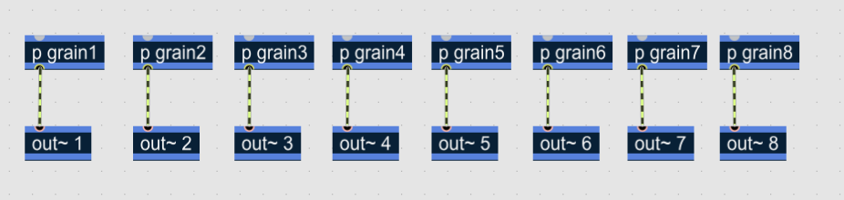

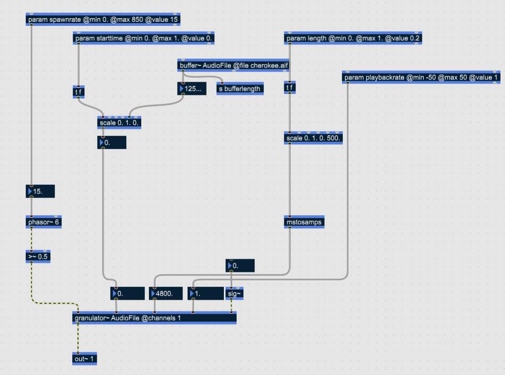

As stated already under "Concept", the initial idea was to make a real spatial granular synth, what means that each grain contains spatial information. Through a false assumption in the beginning, i believed that its not possible with all of the named Techniques. Much later I realized that with Technique 1. & 2. & maybe Tech 3 it's really much possible, the problem I was encountering was about triggering the grains not about accessing the single grain audio buffers. However, I was so far with the development of the spatial voices / granular streams approach that i decided to stick with it for the First Term Project. And follow the actual spatial grains approach in further development. 

## Particle System / Motion Generation System

This component is a Particle System fully implemented in TouchDesigner on a GLSL Compute Shader. I developed it from scratch as personal project over the last 1-2 years. I could just use it in the way that i stream particle positions (and other attributes) out of the component as a texture, which then got fed into the input of the Audio Rendering System.

So a lot of work in this section was already done when i started this project. However, during the semester i rewrote & added some functions. I also threw some stuff out, tried to make it more readable / cleaned up (there can be done a lot more, lot of unused junk functions in the code), nevertheless it's still a separate version, that grew out of the initial work in the last months. The file can be found [here](./../td/tox/Particle_System.tox) & the GLSL Main Code [here](./../glsl/compute_main_particle_system.glsl).

Later in the work on this project i added some more outputs to get more particle attributes for using them as modulation sources like the velocity, life or rotation. I also added some functions, like the "Circular Force" Function or the Trail Function. 

## Audio Rendering System 

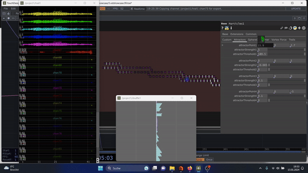

The audio rendering system is entirely written and implemented in TouchDesigner. 3/5 days of the project weeks time went into this. 

To give a rough description, its a distance based amplitude panning system which works dynamically with any amount of speakers & sound sources. It takes the speaker positions as a csv table & the sound source positions as texture object since the calculation of the distances of each sound source positions to each speaker is allocated to the GPU via a GLSL compute shader. 

It started as a sidework which i programmed for an interactive installation i exhibited with the collective "Latenter Raum" some friend & me are running since a year. Our installation piece "Kontakt" was exhibtied at the 37th Chaos Communication Congress 37C3 at the art & play space organized by the "Artes Mobiles" team. Originally the sound part of "Kontakt" was suited for a simple stereo speaker setup but as we had the opportunity to use a 4 channel speaker setup, i wrote a simple distance based amplitude panner for 4 speakers in python / TouchDesigner. This tool build the base of what later became a dynamic Audio Panning System in TouchDesigner. In the beginning it simply took a mono sound source as input and based on the distance from source position associated with this sound source and the virtualized speaker positions, it calculated the actual amplitude level for each speaker. I've added a lookup function that evaluated the distance in a certain range onto a curve. So this gave the possibility to have a amplitude falloff curve, instead of linear fading of the audio level. In the project week i worked a lot on this component to make it a uniform system, that is dynamic & scalable. I programmed the following functionality in the project week: 

Dynamic number of sound sources

Dynamic number of speakers 

Falloff / Attenuation Curves Per Sound Source

Optimization
was the actual last step of development. As already mentioned, initially the distance calculation was running entirely on the CPU via a python script. In the project week, I rewrote the functionality on a GLSL compute shader, that made it it much faster. 

---

## Work Process & Reflection

I started in october. Only with audio related stuff. The whole Audio Synthesis Work documented here was done somewhen in november I think, not the export VST / conversion to RNBO tho. Then, till christmas, a lot of sidework was done (TI Course, XR Course, GLSL/TouchDesigner Workshop, personal projects). I call it sidework, as it later turned out to be really useful for this project aswell, if not directly through code then indirectly through working in same environments. In the example of TI, some of the code/tools written in that context i could one to one use in this project ([Handtracking Data Selector](./../td/tox/select_hand.tox), [Attribute Bake To Texture Tool](./../houdini/hda_tools/houdini20/sop_js812.dev.Attribute_Bake_To_Texture.1.0.hdalc)). In XR & the TouchDesigner Workshops it was more the case that I learned things there, which I applied in this project. 

In the project week I was super productive. At least 45 hours of work were put into this project in it. I managed to convert my max patches to RNBO Patches and then to VST3 Instruments i could successfully use in TouchDesigner. I wrote the complete Audio Rendering System in this week (s.Audio Rendering System) & managed to optimize it in a way that the heavy computation is entirely running on the GPU. Much time went into making this component completely dynamic, which means that it theoretically works for any number of sound sources and any number of speakers, and that it automatically reconfigures itself by just plugging in more audio sources or more speakers in the speaker table. 

Some weeks later, i started working on the whole UI & Modulation System. In the end, i reworked the UI constantly and implemented the Preset System aswell as the Interaction System. I tried to continue to work with tables & that style of programming that everything is dynamicly reacting onto changes on these tables or to relevant changes in the incoming data structure. For example the preset / save system aswell as the modulation system took quite a lot of work to implement but now are super fastly reconfigurable by just adding a parameter name in a table and streaming the data of the parameter having that name into the system. Same goes for the UI, it just looks onto these tables and when it detects a change there it updates itself. The whole UI Update / Callback Function writing took me a lot of time (&nerves) aswell, but was worth it. However i got the feeling i might have done things to complicated or being too chaotic with the the rules on which level a preset callback script is laying. Regarding UI, the style of building small modules that combine into bigger (s.Soundpartikel Section in UI / Overview) i consdier really useful, because when i want to extend the system, for example when adding another synth engine that has more then 4 parameters per voice, it would work extremely fast to implemnt this change with the Instancing-Way the UI is visually & logically built. What i didn't managed on the crucial UI Part, the Soundpartikel Section, is the separation of the Modulation Calculations from the UI Objects that didn't need to be updated as much as the Modulation Functions. With some parts of the UI i managed to do that (Interface Menus) & and have the UI Container only stream out&in data when its updated. But for the Soundpartikel Sectrion a big update is needed in the future. Also the preset / save system needs to be implemented in a more unified way & maybe also on a higher level than now. That is because its also sitting inside the Main UI Container, which is ok in the sense that it is still only updated when certain UI Events occur but as there might be more parameters to save then only the ones of UI Objects it means that an additional data stream into the Main UI Container is needed.

In the last week before the final deadline, i made quite a lot of test with 4 speakers in the Spatial Audio Lab & on headphones (binaural listening), some parts of that can be seen/heard in the video linked under Example Links at the end of this site. 

Thinking of my [Project Plan](./../documentation/project_plan.md) i guess im somewhere between best & worst case scenario, but i feel like im closer to the best case scenario, tho i objectively may be pretty much in the middle between both. However, personally, I'm very happy with the state of the project and I'm really much looking forward to extending it in the future.

Therefore, some Ideas / Todos / Todofurthers at the end: 

- Motion Player System
    - Implementation Houdini <-> TouchDesigner Pipeline
    - Multiple Ways to apply baked motion onto particles (force, direct position transfer)

- Particle System
    - Set Parameter Ranges better (eg. circular or attraction force strenghts) / Add Exponential Value Curve for some
    - Clean Up Code
    - Per Particle Attributes & simple Genetic Algorithms 
        -> going towards Autonomous Agent Simulation 
        -> going towards Artificial Life Simulation 
    - Physical Simulations (Gravity Force, Springs)

- UI Improvements
    - Work on the Visual Arrangement
    - "Activate Global Audio Output" Button
    - "Select Global Audio Output Device" Dropdownmenu
    - "Load Audio Samples" Button
    - Monitor Selected Audio Sample per Voice
    - Activate handtracking Input / Switch Between Recordings and Live Input / Recordings Selector
    - The whole of the Interaction Menus are too small, they could be merged into a big Modulation Section 
    - The Modulation Section should be switchable with the Soundpartikel Section (same size, ergo much bigger)
    - encapsoulate Modulation Computation from Soundpartikel UI, general clean separation between UI & any computation

- Modulation System
    - Add Classic Modulation Signal Generators (LFOs + ADSR Envelopes)
    - Find Easy Way to apply Modulation to Global Parameters (especially global particle parameters)

- Multiple Spatial Granular Synth Approaches:
    - Spatial Voices (Now)
    - Spatial Grains (Tech 1. -> No VST, But Synth in Max in Background)

- Multiple Audio Engines:
    - DBAP Audio Renderer (TouchDesigner)
    - "spat." Audio Renderer (Max)
 
- OSC Interfaces
    - UI Data to Max
    - Particle / Distance Data to Max
    - Preset Data To Max
    - All the Data from Max back to TouchDesigner 

- Preset Interpolator 
    - Multi Layered Perceptron Regression Tech, between N Presets in 3D, using Flucoma Library in Max, Proof of Concept Patch can be found [here](./../max/nnparms3D.maxpat)
    - first test implementation in TouchDesigner with small OSC Interface can be found [here](./../td/tox/Parameter_Projection_3D.tox)
    - Linear Interpolation between 2 Presets, everything (preset1, preset2, lerp_value) should be able to be modulated 

## Example Links 

[Usecase Recording](https://youtu.be/aX2tZQe-OFI) (Version 12.03)

Follow Soon: 

[Tutorial](https://therewillbeareallinksoon.com) - How to use grain3d -  
[Usecase Recording](https://therewillbeareallinksoon.com) (Version 15.03)  